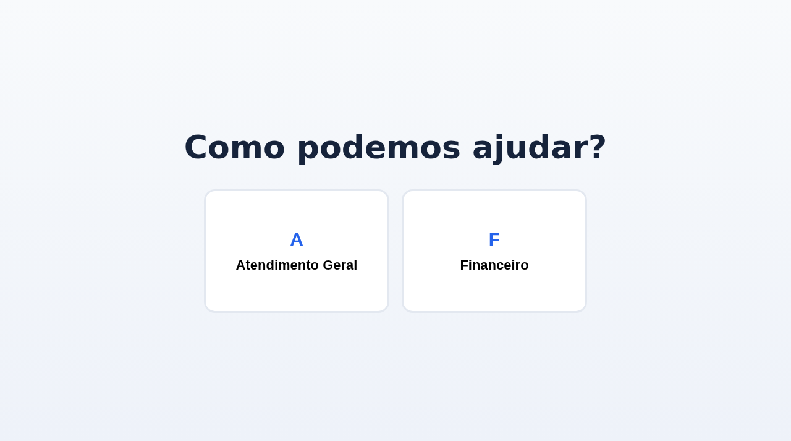
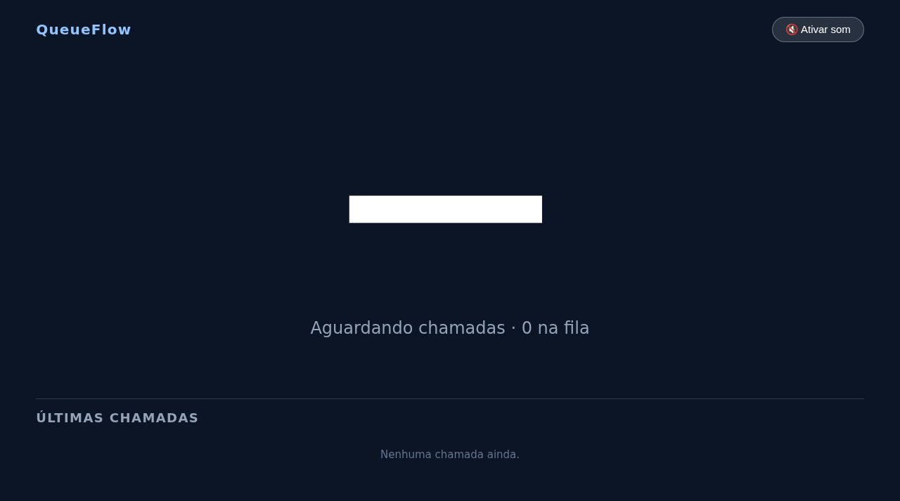

# QueueFlow

Sistema full stack para gerenciamento de filas de atendimento em tempo real: senhas, guichês e o andamento da fila atualizados instantaneamente via WebSocket, com painel administrativo, tela operacional de atendimento e rotas públicas de totem e display.

O projeto separa frontend e backend (React/TypeScript na interface e API Java/Spring Boot com PostgreSQL), com autenticação JWT e autorização por papel.

## Demonstração

**Frontend (produção):** https://oenzoa-queueflow.web.app

> O link acima abre o frontend. A API é utilizada pela interface e roda separadamente no Azure App Service. Os dados da demonstração podem ser redefinidos.

**Conta demo (atendente):** `demo@queueflow.app` / `Demo@2026`

O acesso administrativo é provisionado internamente via bootstrap do backend (variáveis `QUEUEFLOW_BOOTSTRAP_*`) e não possui credencial pública.

## Telas

Totem público de retirada de senhas:



Painel público de acompanhamento das chamadas:



## Sobre o projeto

O QueueFlow foi desenvolvido para organizar o fluxo de atendimento de estabelecimentos, permitindo controlar senhas, guichês e o andamento da fila por meio de uma aplicação web, com atualização em tempo real entre as telas.

## Perfis de acesso

**Administrador (ADMIN):** acesso ao painel administrativo e à configuração da operação.

**Atendente (ATTENDANT):** acesso à tela operacional de atendimento.

**Totem e Display:** rotas públicas para emissão e exibição de senhas, sem necessidade de login.

## Principais funcionalidades

Gerenciamento de filas e senhas.

Controle de guichês de atendimento.

Painel com informações da operação.

Atualizações em tempo real com WebSocket (STOMP/SockJS).

Autenticação e autorização com JWT.

Persistência de dados em PostgreSQL com migrações Flyway.

Validação de dados e tratamento centralizado de erros.

Estrutura preparada para execução com Docker.

## Tecnologias

**Frontend:** React, TypeScript, Vite, React Router, Axios, STOMP/SockJS, Lucide React.

**Backend:** Java 21, Spring Boot 3, Spring Web, Spring Data JPA, Spring Security, Spring WebSocket, JWT, Flyway, PostgreSQL.

**Infraestrutura:** Docker, Docker Compose, Azure App Service (backend), Firebase Hosting (frontend), PostgreSQL gerenciado (Aiven).

## Arquitetura / Estrutura

```text
queueflow/
├── backend/          API Spring Boot (REST + WebSocket)
├── frontend/         Aplicação React + TypeScript (Vite)
├── docker-compose.yml
├── Dockerfile
├── netlify.toml
└── DEPLOY.md
```

## Como executar

Opção 1: Docker Compose (sobem os serviços necessários ao ambiente local):

```bash
docker compose up
```

Opção 2: backend manualmente. O secret JWT não é versionado. Use o perfil local de exemplo:

**Passo 1.** Copie o perfil local e defina o seu secret:

```bash
cp backend/src/main/resources/application-local.yml.example backend/src/main/resources/application-local.yml
```

**Passo 2.** Edite `application-local.yml` e troque `app.jwt.secret` por um secret seu (ex.: string base64 de 32+ caracteres).

**Passo 3.** Rode com o perfil `local` (o frontend em desenvolvimento usa o proxy do Vite para `http://localhost:8080`):

```bash
cd backend
SPRING_PROFILES_ACTIVE=local ./mvnw spring-boot:run
cd ../frontend && npm install && npm run dev
```

Configuração atual de hospedagem na seção [Deploy](#deploy). O arquivo [`DEPLOY.md`](DEPLOY.md) registra o ambiente antigo no Render.

## Variáveis de ambiente

Backend em produção (`backend/.env.example`):

| Variável | Descrição |
|---|---|
| `SPRING_DATASOURCE_URL` / `SPRING_DATASOURCE_USERNAME` / `SPRING_DATASOURCE_PASSWORD` | Conexão PostgreSQL |
| `JWT_SECRET` | Secret JWT (obrigatório no perfil `prod`) |
| `FRONTEND_URL` | Origem do frontend para CORS |
| `PORT` | Porta do serviço (padrão 8080) |

Frontend (`frontend/.env.example`): `VITE_API_URL` (origem da API em produção, em desenvolvimento o proxy do Vite cobre) e `VITE_WS_URL` (opcional, derivado da API).

## Segurança e privacidade

Autenticação por JWT e autorização por papel: telas administrativas exigem `ADMIN` e a tela operacional exige `ATTENDANT`.

Senhas armazenadas apenas como hash. A conta administrativa é provisionada internamente pelo bootstrap do backend, sem credencial pública.

Totem e display são públicos por design e não coletam dados pessoais dos clientes atendidos.

Páginas de [Termos de Uso](https://oenzoa-queueflow.web.app/termos) e [Política de Privacidade](https://oenzoa-queueflow.web.app/privacidade) disponíveis no rodapé do login.

## Testes

Backend: testes automatizados (integração e política de chamada de senhas) executados com `./mvnw test` e validados no CI a cada push.

Frontend: validado por build no CI (sem testes automatizados).

## Deploy

Frontend (produção): https://oenzoa-queueflow.web.app (Firebase Hosting, deploy via GitHub Actions).

Backend (produção): https://queueflow-backend-oe.azurewebsites.net (Azure App Service B1, container GHCR, Always On + WebSockets).

Banco de dados: PostgreSQL gerenciado no Aiven (preservado na migração Render → Azure).

O arquivo [`DEPLOY.md`](DEPLOY.md) preserva as instruções do ambiente anterior no Render. O antigo `render.yaml` foi removido da árvore atual e pode ser consultado no histórico do Git. O plano de Cloud Run em `docs/cloudrun-deploy.md` também é histórico e não descreve a hospedagem atual.

## Status

Versão estável publicada e em produção nos links acima.

## Limitações conhecidas

O backend está documentado em Azure App Service B1 com Always On. O aviso de hibernação por inatividade do antigo plano gratuito do Render não se aplica a essa configuração. Reinícios ou novas publicações ainda podem exigir a reconexão do WebSocket. Os dados da demonstração podem ser redefinidos.

O projeto atende a um único estabelecimento por instância.

O frontend não possui testes automatizados. É validado por build no CI.

## Autor

Enzo Almeida
